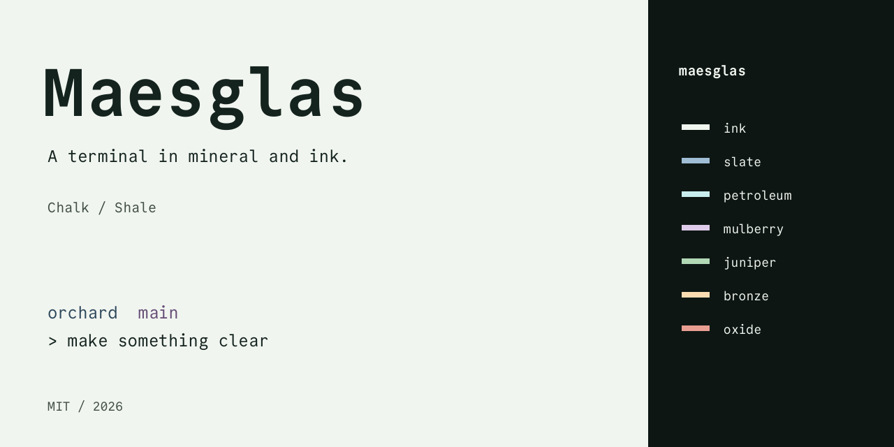
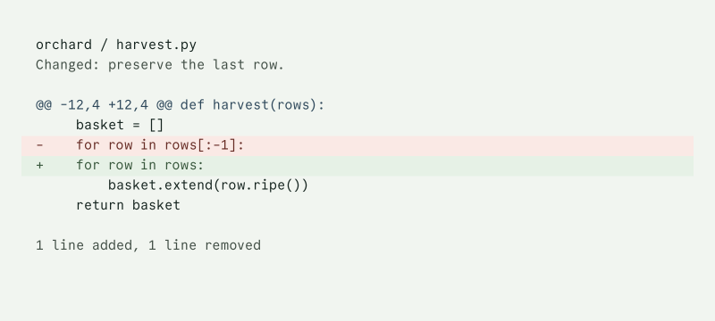

# Maesglas

A terminal in mineral and ink. Chalk is the light default: cool paper,
green-black text, and a few dark pigments that separate structure from
state. Shale carries the same relationships onto a dark ground.

*Maesglas* joins the Welsh words *maes*, a field, and *glas*, a color
word spanning blue, green, and gray.



## The palette

| Ink | Slate | Petroleum | Mulberry | Juniper | Bronze | Oxide |
| --- | --- | --- | --- | --- | --- | --- |
| `#14231E` | `#2D475A` | `#366F72` | `#654C75` | `#38573C` | `#795A2A` | `#662B24` |

The weakest Chalk text pair is 4.559:1. Every ANSI slot is
readable text, including black and white. Both variants are checked on
selection, search, and diff grounds as well as the canvas.
[Full contrast report](docs/palette.md).



The [specimen page](site/index.html) includes prompts, code, a directory
listing, an editor, and a review. These are synthetic drawings, not
application screenshots. [Design rationale](docs/design.md).

## Install

Choose one variant across the terminal and its tools. The examples use
`chalk`; substitute `shale` for the dark companion. Set `THEME_DIR` to
the destination you chose for that application. Back up existing files
before copying. These files change appearance, not your shell setup.

Extract the ports archive and run the copy commands from its root, where
the `ports/` directory lives. The same commands work from the repository root.

Install the face separately using the [typography guide](docs/typography.md).
Fonts are not included in the ports. Maesglas is independent of every
tool listed below.

<details>
<summary>Ghostty</summary>

Load the file with `config-file`. [checked: Ghostty 1.3.1, 2026-10-24]

```sh
mkdir -p "${THEME_DIR:?Choose a destination directory}"
cp ports/ghostty/maesglas-chalk.conf "$THEME_DIR/maesglas-chalk.conf"
```

After copying, load the preset with the following setting.
Replace `/path/to` with your chosen directory when editing a configuration file.
[checked: Ghostty 1.3.1, 2026-10-24]

```text
config-file = /path/to/maesglas-chalk.conf
```

</details>

<details>
<summary>Starship</summary>

Point `STARSHIP_CONFIG` at the preset. [checked: Starship 1.27.0, 2026-10-24]

```sh
mkdir -p "${THEME_DIR:?Choose a destination directory}"
cp ports/starship/maesglas-chalk.toml "$THEME_DIR/maesglas-chalk.toml"
```

After copying, load the preset with the following setting.
Replace `/path/to` with your chosen directory when editing a configuration file.
[checked: Starship 1.27.0, 2026-10-24]

```sh
export STARSHIP_CONFIG="$THEME_DIR/maesglas-chalk.toml"
```

</details>

<details>
<summary>Vim</summary>

Source the appearance file after your other settings. [checked: Vim 9.1, 2026-10-24]

```sh
mkdir -p "${THEME_DIR:?Choose a destination directory}"
cp ports/vim/maesglas-chalk.vim "$THEME_DIR/maesglas-chalk.vim"
```

</details>

<details>
<summary>bat and delta</summary>

Build the theme cache before selecting the theme. [checked: bat 0.26.1 and delta 0.20.1, 2026-10-24]

```sh
mkdir -p "${THEME_DIR:?Choose a destination directory}"
cp ports/textmate/maesglas-chalk.tmTheme "$THEME_DIR/maesglas-chalk.tmTheme"
```

</details>

<details>
<summary>delta</summary>

Include the file, then compose the named feature. [checked: delta 0.20.1, 2026-10-24]

```sh
mkdir -p "${THEME_DIR:?Choose a destination directory}"
cp ports/delta/maesglas-chalk.gitconfig "$THEME_DIR/maesglas-chalk.gitconfig"
```

</details>

<details>
<summary>Git</summary>

Include the file; identity and signing remain unchanged. [checked: Git 2.56.0, 2026-10-24]

```sh
mkdir -p "${THEME_DIR:?Choose a destination directory}"
cp ports/git/maesglas-chalk.gitconfig "$THEME_DIR/maesglas-chalk.gitconfig"
```

</details>

<details>
<summary>nano</summary>

Include the file after other appearance settings. [checked: nano 9.2, 2026-10-24]

```sh
mkdir -p "${THEME_DIR:?Choose a destination directory}"
cp ports/nano/maesglas-chalk.nanorc "$THEME_DIR/maesglas-chalk.nanorc"
```

</details>

<details>
<summary>fzf</summary>

Source the file after other picker options. [checked: fzf 0.74.5, 2026-10-24]

```sh
mkdir -p "${THEME_DIR:?Choose a destination directory}"
cp ports/fzf/maesglas-chalk.sh "$THEME_DIR/maesglas-chalk.sh"
```

</details>

<details>
<summary>tmux</summary>

Source the file from your configuration. [checked: tmux 3.8, 2026-10-24]

```sh
mkdir -p "${THEME_DIR:?Choose a destination directory}"
cp ports/tmux/maesglas-chalk.conf "$THEME_DIR/maesglas-chalk.conf"
```

</details>

<details>
<summary>eza</summary>

Copy the file as `theme.yml` in `EZA_CONFIG_DIR`. [checked: eza 0.23.5, 2026-10-24]

```sh
mkdir -p "${THEME_DIR:?Choose a destination directory}"
cp ports/eza/maesglas-chalk.yml "$THEME_DIR/theme.yml"
```

</details>

<details>
<summary>glow</summary>

Pass the file to `glow --style`. [checked: glow 3.0.0, 2026-10-24]

```sh
mkdir -p "${THEME_DIR:?Choose a destination directory}"
cp ports/glow/maesglas-chalk.json "$THEME_DIR/maesglas-chalk.json"
```

</details>

<details>
<summary>lazygit</summary>

Merge the `gui` mapping into your configuration. [checked: lazygit 0.66.2, 2026-10-24]

```sh
mkdir -p "${THEME_DIR:?Choose a destination directory}"
cp ports/lazygit/maesglas-chalk.yml "$THEME_DIR/maesglas-chalk.yml"
```

</details>

<details>
<summary>yazi</summary>

Copy as `theme.toml`; use the matching terminal variant. [checked: yazi 26.9.1, 2026-10-24]

```sh
mkdir -p "${THEME_DIR:?Choose a destination directory}/flavors"
cp ports/yazi/maesglas-chalk.toml "$THEME_DIR/theme.toml" && cp -R ports/yazi/maesglas-chalk.yazi "$THEME_DIR/flavors/"
```

</details>

<details>
<summary>Alacritty</summary>

Import the file from `[general].import`. [checked: Alacritty 0.17.0, 2026-10-24]

```sh
mkdir -p "${THEME_DIR:?Choose a destination directory}"
cp ports/alacritty/maesglas-chalk.toml "$THEME_DIR/maesglas-chalk.toml"
```

</details>

<details>
<summary>kitty</summary>

Include the file from your configuration. [checked: kitty 0.49.2, 2026-10-24]

```sh
mkdir -p "${THEME_DIR:?Choose a destination directory}"
cp ports/kitty/maesglas-chalk.conf "$THEME_DIR/maesglas-chalk.conf"
```

</details>

<details>
<summary>WezTerm</summary>

Put the file in `colors/`; select `Maesglas Chalk`. [checked: WezTerm 20240203-110809-5046fc22, 2026-10-24]

```sh
mkdir -p "${THEME_DIR:?Choose a destination directory}"
cp ports/wezterm/maesglas-chalk.toml "$THEME_DIR/maesglas-chalk.toml"
```

</details>

<details>
<summary>Neovim</summary>

Put the file in `colors/`; run `:colorscheme maesglas-chalk`. [checked: Neovim 0.12.6, 2026-10-24]

```sh
mkdir -p "${THEME_DIR:?Choose a destination directory}"
cp ports/neovim/maesglas-chalk.lua "$THEME_DIR/maesglas-chalk.lua"
```

</details>

<details>
<summary>Helix</summary>

Put the file in `themes/`; select `maesglas-chalk`. [checked: Helix 25.07.1, 2026-10-24]

```sh
mkdir -p "${THEME_DIR:?Choose a destination directory}"
cp ports/helix/maesglas-chalk.toml "$THEME_DIR/maesglas-chalk.toml"
```

</details>

<details>
<summary>VS Code</summary>

Copy the extension folder, then select Maesglas Chalk. [checked: VS Code 1.143.1, 2026-10-24]

```sh
mkdir -p "${THEME_DIR:?Choose an extensions directory}/maesglas"
cp ports/vscode/*.json ports/vscode/LICENSE "$THEME_DIR/maesglas/"
```

</details>

<details>
<summary>Zed</summary>

Put the file in `themes/`, then select Maesglas Chalk. [checked: Zed schema 0.2.0, 2026-10-24]

```sh
mkdir -p "${THEME_DIR:?Choose a destination directory}"
cp ports/zed/maesglas-chalk.json "$THEME_DIR/maesglas-chalk.json"
```

</details>

<details>
<summary>iTerm2</summary>

Import the file through the profile's color presets. [checked: iTerm2 3.6.6, 2026-10-24]

```sh
mkdir -p "${THEME_DIR:?Choose a destination directory}"
cp ports/iterm2/maesglas-chalk.itermcolors "$THEME_DIR/maesglas-chalk.itermcolors"
```

</details>

<details>
<summary>Windows Terminal</summary>

Add the object to `schemes`; select `Maesglas Chalk`. [checked: Windows Terminal 1.25.2733.0, 2026-10-24]

```sh
mkdir -p "${THEME_DIR:?Choose a destination directory}"
cp ports/windows-terminal/maesglas-chalk.json "$THEME_DIR/maesglas-chalk.json"
```

</details>

<details>
<summary>k9s</summary>

Put the file in `skins/`; set `k9s.ui.skin: maesglas-chalk`. [checked: k9s 0.51.0, 2026-10-24]

```sh
mkdir -p "${THEME_DIR:?Choose a destination directory}"
cp ports/k9s/maesglas-chalk.yaml "$THEME_DIR/maesglas-chalk.yaml"
```

</details>

<details>
<summary>gh-dash</summary>

Merge the `theme` mapping into your configuration. Fixed status icons are not contrast-certified; see the port notes. [checked: gh-dash 4.26.0, 2026-10-24]

```sh
mkdir -p "${THEME_DIR:?Choose a destination directory}"
cp ports/gh-dash/maesglas-chalk.yml "$THEME_DIR/maesglas-chalk.yml"
```

</details>

<details>
<summary>fast-syntax-highlighting</summary>

Source the file after loading the plugin. [checked: fast-syntax-highlighting 1.67, 2026-10-24]

```sh
mkdir -p "${THEME_DIR:?Choose a destination directory}"
cp ports/fast-syntax-highlighting/maesglas-chalk.zsh "$THEME_DIR/maesglas-chalk.zsh"
```

</details>

For cache setup, feature composition, validation methods, and limitations,
read the [port notes](docs/ports.md). Unverified formats are omitted.

## Font setup

Download the [1.143 archive](https://github.com/eigilnikolajsen/commit-mono/releases/download/v1.143/CommitMono-1.143.zip),
verify its SHA-256 below, and install its regular, italic, bold, and
bold italic files with your operating system's font installer.
The family name in the files is `CommitMono`.
[checked: Commit Mono 1.143, 2026-10-24]

```text
f7d1f26a7c7554800a996f76f5d706bf0648b936ca2a66b5bc4d46e3a2c49ed0
```

The page uses only upright regular and bold. Its local copies and the
shaped outline cache are covered by [the font notice](THIRD_PARTY_NOTICES.md).
Font installation is a separate, explicit step.

Continue with [font settings and pane arithmetic](docs/typography.md).

For cache setup, feature composition, and the validation boundary, read
[port notes](docs/ports.md). Unverified formats are omitted, not presented
as previews.

## Build

```sh
python3 scripts/generate.py
scripts/gate.sh
```

Generation has no package dependencies and makes no network requests.
The gate uses the versions in `tools.lock`; see
[contributing](CONTRIBUTING.md) for setup.

[MIT license](LICENSE). Version `2026.10.1`.
[Specimen site](https://agh.github.io/maesglas/) and [release preparation](docs/publishing.md).
